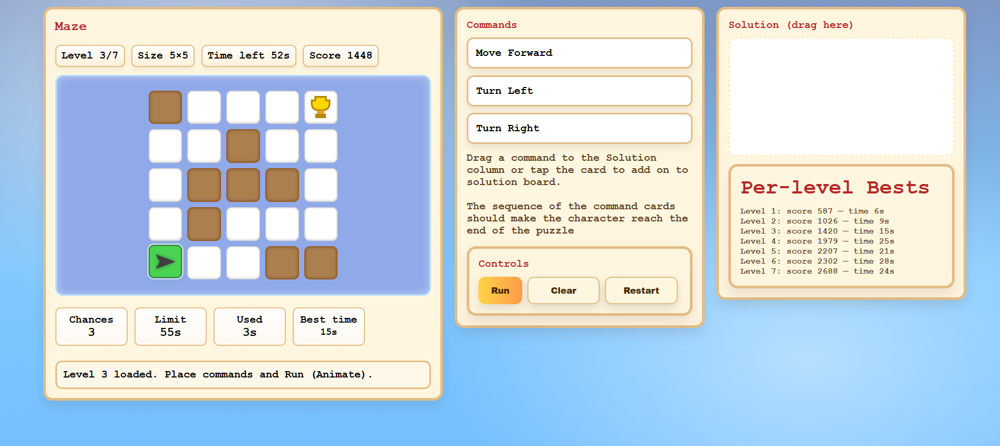

# Twisted Trails

### A command-based maze puzzle game

Twisted Trails is a browser-based maze game created as a **BCA student project**.  
The player plans a sequence of commands, guides a character through a maze, avoids walls and traps, and reaches the goal before time runs out.

> **Navigate the twists. Outsmart the traps.**



## About the Project

The idea behind Twisted Trails is to make maze solving more interactive than simply using keyboard arrows. Instead, the player must think ahead and build a solution using command cards:

- **Move Forward**
- **Turn Left**
- **Turn Right**

The game combines logical thinking, planning, time management, and basic algorithmic problem-solving in a simple visual format.

## Game Modes

### Normal Mode

Explore the maze freely and find the correct route to the real goal. Some levels contain fake goals, so the player must carefully identify the correct destination.

### Precision Mode

Follow the exact shortest path. Reaching the goal through any other route counts as a wrong path and costs one chance.

## Main Features

- 7 progressively challenging maze levels
- Maze sizes from `4x4` up to `9x12`
- Two gameplay modes: Normal and Precision
- Drag-and-drop command cards
- Tap command cards to add them on smaller screens
- Animated command execution
- Countdown timer for every level
- Three chances per level
- Collision detection for walls and out-of-bounds movement
- Fake goals in Normal Mode
- Shortest-path validation in Precision Mode
- Score calculation based on level, time, and moves
- Per-level best scores saved in browser `localStorage`
- Sound effects for countdown, errors, level completion, success, and failure
- Responsive layout for desktop and mobile screens
- Congratulations and Game Over screens

## How to Play

1. Open the game from the home page.
2. Choose **Normal Mode** or **Precision Mode**.
3. Drag command cards into the **Solution** column, or tap a card to add it.
4. Arrange the commands in the order the character should perform them.
5. Click **Run** to execute the sequence.
6. Use **Clear** to remove the current sequence.
7. Use **Restart** to begin again from Level 1.
8. Complete all seven levels with the highest score possible.

### Rules

- You begin each level with **3 chances**.
- Hitting a wall or moving outside the maze costs one chance.
- Running out of time costs one chance.
- In Precision Mode, leaving the shortest path costs one chance.
- A level must be completed before the next level is unlocked.

## Scoring

The score rewards fast and efficient solutions:

```text
Level score = level base + time bonus - step penalty
```

- Higher levels provide a larger base score.
- Remaining time increases the score.
- Every command used adds a small penalty.
- Best scores and completion times are stored separately for each level.

## Technologies Used

- **HTML5** - page structure and game screens
- **CSS3** - responsive layout, animations, colors, and visual design
- **Vanilla JavaScript** - game logic, movement, timers, scoring, and events
- **Browser localStorage** - saving per-level best scores
- **HTML Audio** - game sound effects

No external framework or database is required.

## Project Structure

```text
MAZE_FINAL/
├── index.html          # Home page and mode selection
├── game_M.html         # Normal Mode
├── game.html           # Precision Mode
├── congrats_M.html     # Successful completion screen
├── failed_M.html       # Game Over screen
├── css/
│   └── game.css        # Shared game styles
├── js/
│   └── engine.js       # Shared game engine
├── audio/              # Sound effects
└── photos/
    └── maze_preview.png
```

## How to Run

### Option 1: Open directly

Open `index.html` in a modern web browser.

### Option 2: Use a local server

A local server is recommended for the best browser compatibility:

```bash
python -m http.server 8000
```

Then open:

```text
http://localhost:8000
```

## Learning Outcomes

This project helped me practise:

- Designing a complete interactive web application
- Managing game state with JavaScript
- Working with arrays to represent maze grids
- Handling drag-and-drop and click events
- Creating timers and animated actions
- Applying collision and path validation logic
- Using `localStorage` for client-side data persistence
- Building a responsive user interface with HTML and CSS
- Organising shared logic into a reusable game engine

## Future Improvements

- Procedurally generate unlimited mazes
- Add keyboard controls and touch swipe controls
- Add more player profiles and global leaderboards
- Add difficulty selection
- Add hints with a score penalty
- Add accessibility improvements and colour-blind-friendly themes
- Add unit tests for movement, scoring, and path validation

## Author

**[Your Name]**  
BCA Student  

This project was created as an academic project to demonstrate front-end development, JavaScript programming, and game-design concepts.

## License

This project is intended for educational and academic use.
